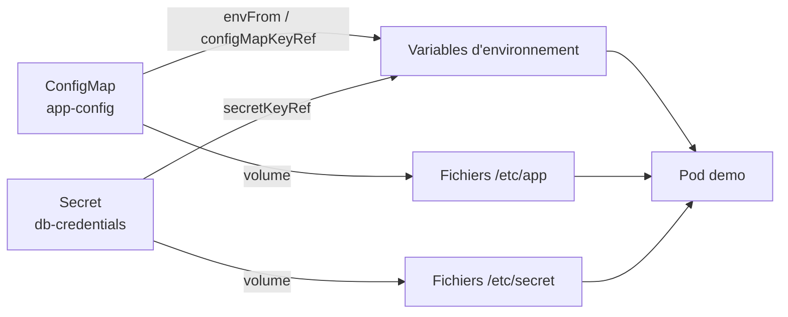
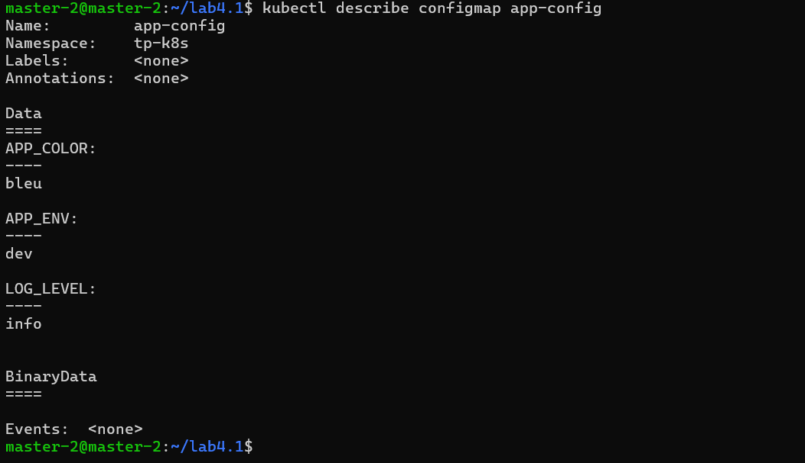
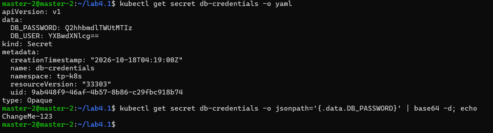
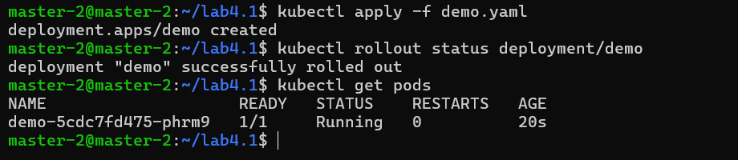
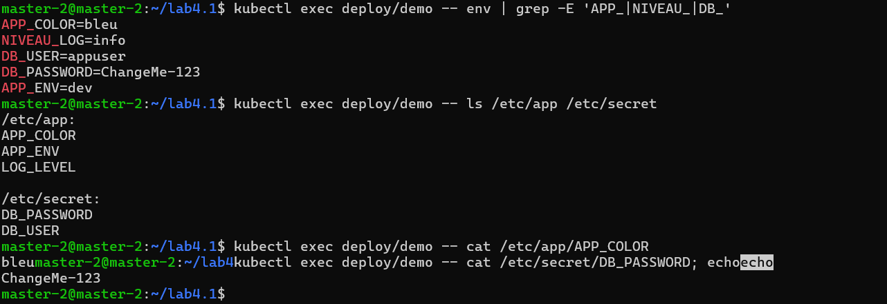
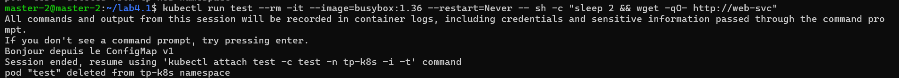
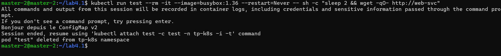
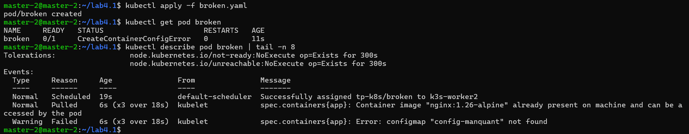
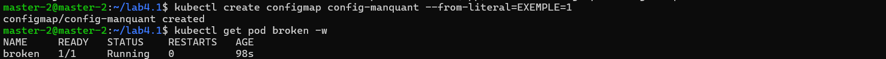

<div align="center">

# Lab 4.1 : Externaliser la configuration

ConfigMap, Secret, variables d'environnement, fichiers montés et diagnostic


</div>

---

> Cette branche contient uniquement le **Lab 4.1**. L'autre partie est sur la branche [`lab4.2`](https://github.com/Narjess805/lab4-configuration-ressources/tree/lab4.2), et la vue d'ensemble sur [`main`](https://github.com/Narjess805/lab4-configuration-ressources/tree/main).

---

## Environnement de travail

| Composant | Détails |
|-----------|---------|
| Cluster | K3s, 3 nœuds `Ready` (1 master + 2 workers) |
| Ressources par VM | environ 2 vCPU et 2 Go de RAM |
| Image utilisée | `nginx:1.26-alpine` (et `busybox:1.36` pour les tests) |
| Namespaces | `tp-k8s` (4.1 et 4.2), `tp-quota` (4.2) |
| Alias | `k` pour `kubectl` |

| Nœud | Rôle | Adresse IP |
|------|------|------------|
| Master | control-plane | `192.168.56.20` |
| Worker 1 | worker | `192.168.56.31` |
| Worker 2 | worker | `192.168.56.32` |

---

## Étapes réalisées et résultats

À partir d'une même image (`nginx:1.26-alpine`), la configuration est fournie de l'extérieur. On observe ensuite comment chaque mode d'injection réagit quand elle change.



### Étape 1 et 2 : Namespace et ConfigMap

```bash
k create namespace tp-k8s
k config set-context --current --namespace=tp-k8s

k apply -f lab4.1/yaml/app-config.yaml
k get configmap app-config
k describe configmap app-config
```

> **Résultat** : le ConfigMap `app-config` contient 3 clés (`APP_ENV`, `APP_COLOR`, `LOG_LEVEL`), lisibles en clair dans `describe`.



---

### Étape 3 : Créer un Secret

Le Secret est créé en ligne de commande, sans écrire de fichier à la main.

```bash
k create secret generic db-credentials \
  --from-literal=DB_USER=appuser \
  --from-literal=DB_PASSWORD='ChangeMe-123'

k describe secret db-credentials
k get secret db-credentials -o yaml
k get secret db-credentials -o jsonpath='{.data.DB_PASSWORD}' | base64 -d; echo
```

> **Résultat** : `describe` n'affiche que la taille des valeurs, le YAML les montre encodées en base64, et `base64 -d` retrouve le mot de passe. **Encoder n'est pas chiffrer.**



> **Attention** : le fichier `secret.yaml` généré avec `--dry-run=client -o yaml` contient le vrai mot de passe. Il est exclu par le `.gitignore` ; seul le modèle `secret.example.yaml` (fausses valeurs) est versionné.

---

### Étape 4 : Injecter la configuration dans un Deployment

Le Deployment `demo` combine les quatre modes d'injection :

| Mode | Source | Résultat dans le conteneur |
|------|--------|----------------------------|
| `configMapKeyRef` | une clé du ConfigMap | variable `NIVEAU_LOG` (clé renommée) |
| `secretKeyRef` | clés du Secret | variables `DB_USER`, `DB_PASSWORD` |
| `envFrom` | tout le ConfigMap | une variable par clé |
| `volume` | ConfigMap et Secret | fichiers dans `/etc/app` et `/etc/secret` (`readOnly`) |

```bash
k apply -f lab4.1/yaml/demo.yaml
k rollout status deployment/demo
k get pods
```

> **Résultat** : le Pod `demo` est `Running`.



---

### Étape 5 : Vérifier l'injection

```bash
k exec deploy/demo -- env | grep -E 'APP_|NIVEAU_|DB_'
k exec deploy/demo -- ls /etc/app /etc/secret
k exec deploy/demo -- cat /etc/app/APP_COLOR
k exec deploy/demo -- cat /etc/secret/DB_PASSWORD; echo
```

> **Résultat** : `APP_ENV`, `APP_COLOR`, `NIVEAU_LOG`, `DB_USER` et `DB_PASSWORD` apparaissent dans l'environnement. `/etc/app` contient un fichier par clé du ConfigMap et `/etc/secret` un fichier par clé du Secret.



---

### Étape 6 : Modifier la configuration et observer

```bash
sed -i 's|APP_COLOR: bleu|APP_COLOR: vert|' lab4.1/yaml/app-config.yaml
k apply -f lab4.1/yaml/app-config.yaml
k exec deploy/demo -- sh -c 'echo "variable : $APP_COLOR"; echo "fichier   : $(cat /etc/app/APP_COLOR)"'

# Après 1 à 2 minutes, puis après redémarrage
k rollout restart deployment/demo
k rollout status deployment/demo
```

| Moment | Variable `APP_COLOR` | Fichier `/etc/app/APP_COLOR` |
|--------|:--------------------:|:----------------------------:|
| Juste après `apply` | `bleu` | `bleu` |
| Après 1 à 2 minutes | `bleu` | `vert` |
| Après `rollout restart` | `vert` | `vert` |

> **Résultat** : le fichier monté est rafraîchi par le kubelet après un délai, alors que la variable d'environnement reste figée jusqu'au redémarrage du Pod.

<!-- Capture manquante : ajouter 05_modification_config.png puis retirer ces marqueurs

-->

---

### Étape 7 : Monter un fichier de configuration dans nginx

Un ConfigMap fournit `default.conf`, monté avec `subPath` dans `/etc/nginx/conf.d/`.

```bash
k apply -f lab4.1/yaml/web.yaml
k rollout status deployment/web
k run test --rm -it --image=busybox:1.36 --restart=Never -- wget -qO- http://web-svc

# Passage de v1 à v2
sed -i 's|ConfigMap v1|ConfigMap v2|' lab4.1/yaml/web.yaml
k apply -f lab4.1/yaml/web.yaml
k exec deploy/web -- cat /etc/nginx/conf.d/default.conf
k rollout restart deployment/web
```

> **Résultat** : nginx sert d'abord le message `v1` du ConfigMap. Après modification, le contenu servi reste `v1` : **un montage `subPath` n'est jamais rafraîchi**. Après `rollout restart`, la réponse annonce `v2`.





---

### Étape 8 : Diagnostiquer une configuration manquante

```bash
k apply -f lab4.1/yaml/broken.yaml
k get pod broken
k describe pod broken | tail -n 8

k create configmap config-manquant --from-literal=EXEMPLE=1
k get pod broken -w
```

> **Résultat** : le Pod est en `CreateContainerConfigError` et la section Events donne le nom du ConfigMap introuvable. Après création du ConfigMap, le Pod passe à `Running` sans être recréé.





---

### Nettoyage

```bash
k delete namespace tp-k8s
k config set-context --current --namespace=default
rm -f secret.yaml
```

<!-- Capture à ajouter : adapter le nom du fichier puis retirer ces marqueurs

-->

### Questions de réflexion (Lab 4.1)

<details>
<summary><strong>1. Pourquoi la variable APP_COLOR n'a-t-elle pas changé alors que le fichier si ?</strong></summary>

Les variables d'environnement sont fixées au démarrage du conteneur. Un ConfigMap monté en volume est mis à jour par le kubelet après un délai. Il faut relancer les Pods pour renouveler les variables.
</details>

<details>
<summary><strong>2. Pourquoi le contenu servi par nginx est-il resté en v1 ?</strong></summary>

Un montage avec `subPath` n'est pas rafraîchi automatiquement. Et même si le fichier changeait, nginx ne relirait pas sa configuration sans rechargement. Un `rollout restart` règle le problème.
</details>

<details>
<summary><strong>3. Quel est l'intérêt de <code>readOnly: true</code> sur le montage du Secret ?</strong></summary>

Elle empêche le conteneur de modifier les fichiers du Secret : c'est une précaution de moindre privilège.
</details>

<details>
<summary><strong>4. Quelle différence entre <code>envFrom</code> et <code>configMapKeyRef</code> ?</strong></summary>

`envFrom` injecte toutes les clés du ConfigMap comme variables, avec leur nom. `configMapKeyRef` choisit une seule clé et permet de lui donner un autre nom de variable.
</details>

<details>
<summary><strong>5. Comment vérifier qu'aucun secret réel ne se trouve dans un dépôt Git ?</strong></summary>

En inspectant `git status` et le contenu des fichiers versionnés, en ajoutant les fichiers de Secret au `.gitignore`, et en ne gardant dans le dépôt qu'un fichier modèle avec de fausses valeurs.
</details>

### Dépannage (Lab 4.1)

| Symptôme | Pistes |
|----------|--------|
| `CreateContainerConfigError` | `k describe pod` : ConfigMap, Secret ou clé introuvable (nom, namespace, faute de frappe) |
| `base64: invalid input` | Valeur copiée avec un espace ou un retour à la ligne : refaire la copie |
| Mot de passe décodé incorrect | Encodage avec `echo` qui ajoute un retour à la ligne : utiliser `echo -n` |
| La variable ne change pas après modification | Normal : `k rollout restart deployment/<nom>` |
| Le fichier monté ne change pas | Patienter 1 à 2 minutes ; un montage `subPath` n'est jamais rafraîchi |
| nginx renvoie la page par défaut | Vérifier `mountPath`, `subPath` et le nom de la clé (`default.conf`) |


---

## Auteur

| | |
|---|---|
| **Nom** | Dabbech |
| **Prénom** | Narjess |
| **Classe** | M2 DevOps |
| **GitHub** | [@Narjess805](https://github.com/Narjess805) |
| **Date** | Octobre 2026 |
