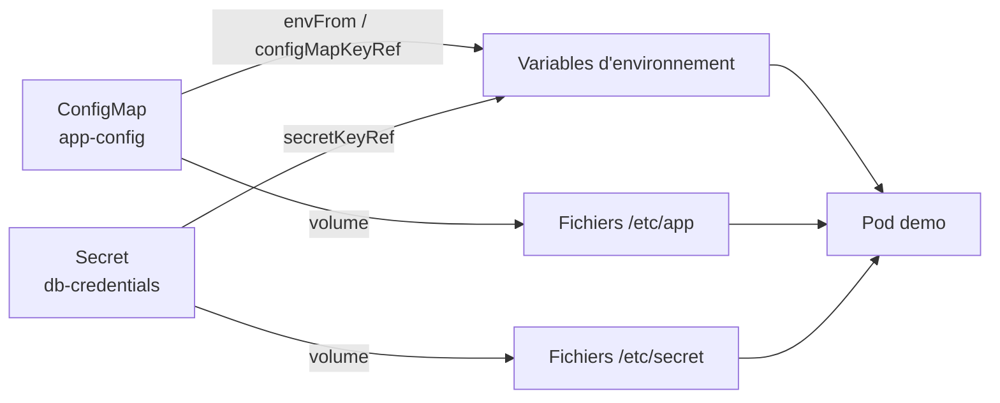
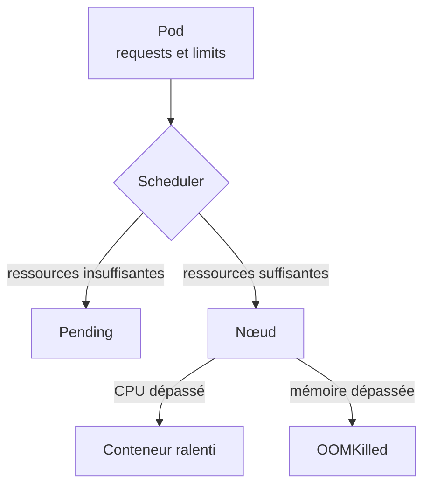

<div align="center">

# Lab 4 : Configuration et ressources sur Kubernetes (K3s)

ConfigMap, Secret, requests et limits, OOMKilled, ResourceQuota et LimitRange


</div>

---

## Table des matières

1. [Présentation](#1-présentation)
2. [Environnement de travail](#2-environnement-de-travail)
3. [Structure du dépôt](#3-structure-du-dépôt)
4. [Partie 1 Configuration (Lab 4.1)](#4-partie-1-configuration-lab-41)
5. [Partie 2 Ressources (Lab 4.2)](#5-partie-2-ressources-lab-42)
6. [Bonnes pratiques retenues](#6-bonnes-pratiques-retenues)
7. [Auteur](#7-auteur)

---

## 1. Présentation

Ce dépôt regroupe les deux labs du chapitre 4, qui portent sur la façon de **piloter une application** déployée sur Kubernetes.

| Partie | Lab | Thème | Objectif principal |
|:------:|-----|-------|--------------------|
| 1 | **Lab 4.1** | Externaliser la configuration | Fournir la configuration d'un conteneur de l'extérieur (ConfigMap, Secret) et observer quand elle est prise en compte |
| 2 | **Lab 4.2** | Maîtriser les ressources | Définir des requests et limits, diagnostiquer `Pending` et `OOMKilled`, encadrer un namespace (ResourceQuota, LimitRange) |

Chaque partie est aussi disponible sur sa propre branche : [`lab4.1`](https://github.com/Narjess805/lab4-configuration-ressources/tree/lab4.1) et [`lab4.2`](https://github.com/Narjess805/lab4-configuration-ressources/tree/lab4.2). La branche `main` contient l'ensemble.

## 2. Environnement de travail

| Composant | Détails |
|-----------|---------|
| Cluster | K3s, 3 nœuds `Ready` (1 master + 2 workers) |
| Ressources par VM | environ 2 vCPU et 2 Go de RAM |
| Image utilisée | `nginx:1.26-alpine` (et `busybox:1.36` pour les tests) |
| Namespaces | `tp-k8s` (4.1 et 4.2), `tp-quota` (4.2) |
| Alias | `k` pour `kubectl` |

| Nœud | Rôle | Adresse IP |
|------|------|------------|
| Master | control-plane | `192.168.56.20` |
| Worker 1 | worker | `192.168.56.31` |
| Worker 2 | worker | `192.168.56.32` |

## 3. Structure du dépôt

```text
.
├── README.md                          # Ce fichier
├── .gitignore                         # Exclut les vrais secrets (secret.yaml)
├── lab4.1/                            # Partie 1 : ConfigMap et Secret
│   ├── yaml/
│   │   ├── app-config.yaml            # ConfigMap app-config
│   │   ├── secret.example.yaml        # Modèle de Secret (fausses valeurs)
│   │   ├── demo.yaml                  # Deployment avec les 4 modes d'injection
│   │   ├── web.yaml                   # ConfigMap + Deployment + Service nginx
│   │   └── broken.yaml                # Pod qui référence un ConfigMap inexistant
│   └── captures/                      # Preuves d'exécution du Lab 4.1
│       ├── 01_configmap.png
│       ├── 02_secret_decode.png
│       ├── 03_demo_running.png
│       ├── 04_injection_verification.png
│       ├── 06_nginx_configmap_v1.png
│       ├── 07_nginx_configmap_v2.png
│       ├── 08_broken_configmap.png
│       └── 09_broken_fixed.png
└── lab4.2/                            # Partie 2 : requests, limits, quotas
    ├── yaml/
    │   ├── app.yaml                   # Deployment avec requests et limits
    │   ├── gourmand.yaml              # Demande de 8Gi (Pending)
    │   ├── oom.yaml                   # Pod provoquant un OOMKilled
    │   ├── cpu.yaml                   # Deux Pods : CPU libre et CPU limité
    │   ├── quota.yaml                 # ResourceQuota
    │   ├── limitrange.yaml            # LimitRange (valeurs par défaut)
    │   └── gros.yaml                  # Pod dépassant le quota de CPU
    └── captures/                      # Preuves d'exécution du Lab 4.2
        ├── 01_capacite_cluster.png
        ├── 02_requests_limits.png
        ├── 03_pod_pending.png
        ├── 04_pod_corrige.png
        ├── 05_oomkilled_watch.png
        ├── 06_oomkilled_describe.png
        ├── 07_cpu_limits.png
        ├── 08_quota_refus.png
        ├── 09_quota_ok.png
        ├── 10_quota_depasse.png
        ├── 11_quota_cpu_refus.png
        ├── 12_quota_reduit.png
        └── 13_nettoyage_lab42.png
```

---

## 4. Partie 1 Configuration (Lab 4.1)

À partir d'une même image (`nginx:1.26-alpine`), la configuration est fournie de l'extérieur. On observe ensuite comment chaque mode d'injection réagit quand elle change.



### Étape 1 et 2 : Namespace et ConfigMap

```bash
k create namespace tp-k8s
k config set-context --current --namespace=tp-k8s

k apply -f lab4.1/yaml/app-config.yaml
k get configmap app-config
k describe configmap app-config
```

> **Résultat** : le ConfigMap `app-config` contient 3 clés (`APP_ENV`, `APP_COLOR`, `LOG_LEVEL`), lisibles en clair dans `describe`.


---

### Étape 3 : Créer un Secret

Le Secret est créé en ligne de commande, sans écrire de fichier à la main.

```bash
k create secret generic db-credentials \
  --from-literal=DB_USER=appuser \
  --from-literal=DB_PASSWORD='ChangeMe-123'

k describe secret db-credentials
k get secret db-credentials -o yaml
k get secret db-credentials -o jsonpath='{.data.DB_PASSWORD}' | base64 -d; echo
```

> **Résultat** : `describe` n'affiche que la taille des valeurs, le YAML les montre encodées en base64, et `base64 -d` retrouve le mot de passe. **Encoder n'est pas chiffrer.**


> **Attention** : le fichier `secret.yaml` généré avec `--dry-run=client -o yaml` contient le vrai mot de passe. Il est exclu par le `.gitignore` ; seul le modèle `secret.example.yaml` (fausses valeurs) est versionné.

---

### Étape 4 : Injecter la configuration dans un Deployment

Le Deployment `demo` combine les quatre modes d'injection :

| Mode | Source | Résultat dans le conteneur |
|------|--------|----------------------------|
| `configMapKeyRef` | une clé du ConfigMap | variable `NIVEAU_LOG` (clé renommée) |
| `secretKeyRef` | clés du Secret | variables `DB_USER`, `DB_PASSWORD` |
| `envFrom` | tout le ConfigMap | une variable par clé |
| `volume` | ConfigMap et Secret | fichiers dans `/etc/app` et `/etc/secret` (`readOnly`) |

```bash
k apply -f lab4.1/yaml/demo.yaml
k rollout status deployment/demo
k get pods
```

> **Résultat** : le Pod `demo` est `Running`.


---

### Étape 5 : Vérifier l'injection

```bash
k exec deploy/demo -- env | grep -E 'APP_|NIVEAU_|DB_'
k exec deploy/demo -- ls /etc/app /etc/secret
k exec deploy/demo -- cat /etc/app/APP_COLOR
k exec deploy/demo -- cat /etc/secret/DB_PASSWORD; echo
```

> **Résultat** : `APP_ENV`, `APP_COLOR`, `NIVEAU_LOG`, `DB_USER` et `DB_PASSWORD` apparaissent dans l'environnement. `/etc/app` contient un fichier par clé du ConfigMap et `/etc/secret` un fichier par clé du Secret.


---

### Étape 6 : Modifier la configuration et observer

```bash
sed -i 's|APP_COLOR: bleu|APP_COLOR: vert|' lab4.1/yaml/app-config.yaml
k apply -f lab4.1/yaml/app-config.yaml
k exec deploy/demo -- sh -c 'echo "variable : $APP_COLOR"; echo "fichier   : $(cat /etc/app/APP_COLOR)"'

# Après 1 à 2 minutes, puis après redémarrage
k rollout restart deployment/demo
k rollout status deployment/demo
```

| Moment | Variable `APP_COLOR` | Fichier `/etc/app/APP_COLOR` |
|--------|:--------------------:|:----------------------------:|
| Juste après `apply` | `bleu` | `bleu` |
| Après 1 à 2 minutes | `bleu` | `vert` |
| Après `rollout restart` | `vert` | `vert` |

> **Résultat** : le fichier monté est rafraîchi par le kubelet après un délai, alors que la variable d'environnement reste figée jusqu'au redémarrage du Pod.

<!-- Capture manquante : ajouter 05_modification_config.png puis retirer ces marqueurs

-->

---

### Étape 7 : Monter un fichier de configuration dans nginx

Un ConfigMap fournit `default.conf`, monté avec `subPath` dans `/etc/nginx/conf.d/`.

```bash
k apply -f lab4.1/yaml/web.yaml
k rollout status deployment/web
k run test --rm -it --image=busybox:1.36 --restart=Never -- wget -qO- http://web-svc

# Passage de v1 à v2
sed -i 's|ConfigMap v1|ConfigMap v2|' lab4.1/yaml/web.yaml
k apply -f lab4.1/yaml/web.yaml
k exec deploy/web -- cat /etc/nginx/conf.d/default.conf
k rollout restart deployment/web
```

> **Résultat** : nginx sert d'abord le message `v1` du ConfigMap. Après modification, le contenu servi reste `v1` : **un montage `subPath` n'est jamais rafraîchi**. Après `rollout restart`, la réponse annonce `v2`.


---

### Étape 8 : Diagnostiquer une configuration manquante

```bash
k apply -f lab4.1/yaml/broken.yaml
k get pod broken
k describe pod broken | tail -n 8

k create configmap config-manquant --from-literal=EXEMPLE=1
k get pod broken -w
```

> **Résultat** : le Pod est en `CreateContainerConfigError` et la section Events donne le nom du ConfigMap introuvable. Après création du ConfigMap, le Pod passe à `Running` sans être recréé.


---

### Nettoyage

```bash
k delete namespace tp-k8s
k config set-context --current --namespace=default
rm -f secret.yaml
```

<!-- Capture à ajouter : adapter le nom du fichier puis retirer ces marqueurs

-->

### Questions de réflexion (Lab 4.1)

<details>
<summary><strong>1. Pourquoi la variable APP_COLOR n'a-t-elle pas changé alors que le fichier si ?</strong></summary>

Les variables d'environnement sont fixées au démarrage du conteneur. Un ConfigMap monté en volume est mis à jour par le kubelet après un délai. Il faut relancer les Pods pour renouveler les variables.
</details>

<details>
<summary><strong>2. Pourquoi le contenu servi par nginx est-il resté en v1 ?</strong></summary>

Un montage avec `subPath` n'est pas rafraîchi automatiquement. Et même si le fichier changeait, nginx ne relirait pas sa configuration sans rechargement. Un `rollout restart` règle le problème.
</details>

<details>
<summary><strong>3. Quel est l'intérêt de <code>readOnly: true</code> sur le montage du Secret ?</strong></summary>

Elle empêche le conteneur de modifier les fichiers du Secret : c'est une précaution de moindre privilège.
</details>

<details>
<summary><strong>4. Quelle différence entre <code>envFrom</code> et <code>configMapKeyRef</code> ?</strong></summary>

`envFrom` injecte toutes les clés du ConfigMap comme variables, avec leur nom. `configMapKeyRef` choisit une seule clé et permet de lui donner un autre nom de variable.
</details>

<details>
<summary><strong>5. Comment vérifier qu'aucun secret réel ne se trouve dans un dépôt Git ?</strong></summary>

En inspectant `git status` et le contenu des fichiers versionnés, en ajoutant les fichiers de Secret au `.gitignore`, et en ne gardant dans le dépôt qu'un fichier modèle avec de fausses valeurs.
</details>

### Dépannage (Lab 4.1)

| Symptôme | Pistes |
|----------|--------|
| `CreateContainerConfigError` | `k describe pod` : ConfigMap, Secret ou clé introuvable (nom, namespace, faute de frappe) |
| `base64: invalid input` | Valeur copiée avec un espace ou un retour à la ligne : refaire la copie |
| Mot de passe décodé incorrect | Encodage avec `echo` qui ajoute un retour à la ligne : utiliser `echo -n` |
| La variable ne change pas après modification | Normal : `k rollout restart deployment/<nom>` |
| Le fichier monté ne change pas | Patienter 1 à 2 minutes ; un montage `subPath` n'est jamais rafraîchi |
| nginx renvoie la page par défaut | Vérifier `mountPath`, `subPath` et le nom de la clé (`default.conf`) |

---

## 5. Partie 2 Ressources (Lab 4.2)

Sans règles, une application gourmande peut gêner toutes les autres. Ce lab provoque volontairement des situations courantes, les diagnostique, puis pose des garde-fous sur un namespace.



### Étape 1 : Lire la capacité du cluster

```bash
k create namespace tp-k8s
k config set-context --current --namespace=tp-k8s

k get nodes -o custom-columns=NOM:.metadata.name,CPU:.status.allocatable.cpu,MEMOIRE:.status.allocatable.memory
k top nodes
k describe node <nom-du-noeud> | grep -A8 "Allocated resources"
```

> **Résultat** : le CPU et la mémoire allouables de chaque nœud sont connus, et la section *Allocated resources* donne les requests et limits cumulées d'un nœud.


---

### Étape 2 : Déclarer des requests et des limits

```bash
k apply -f lab4.2/yaml/app.yaml
k rollout status deployment/app
k get pods -o wide
k describe pod -l app=app | grep -A6 -E "Limits|Requests" | head -n 14
k top pods
```

| | CPU | Mémoire |
|---|:---:|:-------:|
| **requests** (réservé) | `100m` | `64Mi` |
| **limits** (plafond) | `200m` | `128Mi` |

> **Résultat** : les deux Pods sont `Running`, `describe` affiche les requests et limits, et la consommation réelle (`k top pods`) est bien inférieure aux requests.


---

### Étape 3 : Diagnostiquer un Pod Pending

```bash
k apply -f lab4.2/yaml/gourmand.yaml     # demande 8Gi de mémoire
k get pods -l app=gourmand
k describe pod -l app=gourmand | tail -n 6

# Correction
sed -i 's|memory: 8Gi|memory: 64Mi|' lab4.2/yaml/gourmand.yaml
k apply -f lab4.2/yaml/gourmand.yaml
```

> **Résultat** : le Pod reste `Pending` avec le message `Insufficient memory` dans les événements. Après correction de la demande, il passe à `Running`.


---

### Étape 4 : Provoquer un OOMKilled

Ce Pod tente de stocker environ 100 Mo en mémoire avec une limite de 50 Mi.

```bash
k apply -f lab4.2/yaml/oom.yaml
k get pod oom -w
k describe pod oom | grep -A6 "Last State"
k logs oom
k delete pod oom
```

> **Résultat** : `Last State` indique `Reason: OOMKilled` et le code de sortie `137`. Les logs ne contiennent pas `fini` : le conteneur est tué avant la fin, c'est donc `describe` qui donne la cause.


---

### Étape 5 : Observer la limite de CPU

```bash
k apply -f lab4.2/yaml/cpu.yaml
sleep 60
k top pods
k delete -f lab4.2/yaml/cpu.yaml
```

| Pod | Limite CPU | Consommation observée |
|-----|:----------:|:---------------------:|
| `cpu-libre` | aucune | environ 1000m (un cœur entier) |
| `cpu-limite` | `100m` | proche de 100m |

> **Résultat** : le conteneur limité n'est pas arrêté, il est **ralenti**. Le CPU est une ressource compressible, contrairement à la mémoire.


---

### Étape 6 : ResourceQuota puis LimitRange

```bash
k create namespace tp-quota
k config set-context --current --namespace=tp-quota

k apply -f lab4.2/yaml/quota.yaml
k run test --image=nginx:1.26-alpine          # refusé

k apply -f lab4.2/yaml/limitrange.yaml
k run test --image=nginx:1.26-alpine          # accepté
k get pod test -o jsonpath='{.spec.containers[0].resources}'; echo
k describe quota quota
```

| Objet | Rôle | Valeurs |
|-------|------|---------|
| **ResourceQuota** `quota` | Plafonne le namespace | `requests.cpu` 500m, `requests.memory` 512Mi, `limits.cpu` 2, `limits.memory` 1Gi, `pods` 5 |
| **LimitRange** `defaults` | Fournit des valeurs par défaut | requests 50m / 64Mi, limits 200m / 128Mi |

> **Résultat** : sans LimitRange, la création est refusée car le quota impose de déclarer requests et limits. Avec le LimitRange, le Pod `test` est accepté et reçoit automatiquement ses valeurs par défaut. `describe quota` compare `Used` et `Hard`.


---

### Étape 7 : Dépasser le quota

```bash
k create deployment charge --image=nginx:1.26-alpine --replicas=8
sleep 10
k get deployment charge
k describe quota quota
k describe replicaset -l app=charge | tail -n 8

k apply -f lab4.2/yaml/gros.yaml     # 600m de CPU : refusé

k scale deployment charge --replicas=2
```

> **Résultat** : le Deployment est accepté mais n'atteint jamais ses 8 Pods, car le quota limite à 5 Pods (le Pod `test` compte). Le message `exceeded quota` apparaît dans les événements du **ReplicaSet**. Le Pod `gros` est refusé immédiatement (`Forbidden`). Après réduction à 2 réplicas, `Used` repasse sous `Hard`.


---

### Nettoyage

```bash
k delete namespace tp-quota
k delete namespace tp-k8s
k config set-context --current --namespace=default
```


### Questions de réflexion (Lab 4.2)

<details>
<summary><strong>1. Pourquoi un Pod avec <code>requests: memory: 8Gi</code> reste-t-il Pending alors que le conteneur ne consommerait pas autant ?</strong></summary>

Le scheduler se base sur les **requests** (la réservation), pas sur la consommation réelle. Aucun nœud n'a 8 Gi de mémoire non réservée, donc le Pod n'est placé nulle part.
</details>

<details>
<summary><strong>2. Quelle différence entre le dépassement d'une limite de CPU et d'une limite de mémoire ?</strong></summary>

Le CPU est « compressible » : le conteneur est ralenti. La mémoire ne l'est pas : le conteneur est tué (`OOMKilled`) puis redémarré.
</details>

<details>
<summary><strong>3. Où lire la cause d'un OOMKilled ?</strong></summary>

Dans `kubectl describe pod`, section `Last State` : motif `OOMKilled` et code de sortie `137`. Les logs ne le montrent pas, puisque le conteneur est interrompu brutalement.
</details>

<details>
<summary><strong>4. Pourquoi le Pod test a-t-il été refusé avant l'ajout du LimitRange ?</strong></summary>

Le quota porte sur le CPU et la mémoire : chaque Pod doit donc déclarer ses requests et limits. Le LimitRange fournit des valeurs par défaut quand elles sont absentes.
</details>

<details>
<summary><strong>5. Pourquoi le Deployment charge a-t-il été accepté alors que ses Pods ne le sont pas ?</strong></summary>

Le Deployment ne crée pas les Pods lui-même : c'est son ReplicaSet qui le fait. Le quota refuse la création des Pods, d'où l'erreur dans les événements du ReplicaSet et non à l'`apply`.
</details>

### Dépannage (Lab 4.2)

| Symptôme | Pistes |
|----------|--------|
| `k top` : métriques indisponibles | Patienter 1 à 2 minutes ; vérifier les Pods `metrics-server` dans `kube-system` |
| Pod `Pending` | `k describe pod` (Events) : `Insufficient cpu` ou `Insufficient memory`, ou quota ; réduire les requests |
| Le Pod `oom` ne passe pas par `OOMKilled` | Attendre le redémarrage du conteneur, puis consulter `Last State` |
| `cpu-limite` consomme plus que 100m | Attendre la mise à jour des métriques ; refaire `k top pods` après une minute |
| Création refusée : `must specify limits...` | Un quota existe sans LimitRange : ajouter les `resources` ou un LimitRange |
| Création refusée : `exceeded quota` | `k describe quota` : comparer `Used` et `Hard`, puis libérer des ressources |
| Le Deployment reste sous le nombre de réplicas voulu | `k describe replicaset` : chercher l'événement `FailedCreate` |

---

## 6. Bonnes pratiques retenues

| Domaine | Pratique |
|---------|----------|
| Configuration | Séparer le code de la configuration (ConfigMap) et des données sensibles (Secret) |
| Secrets | Le base64 **encode** mais ne **chiffre** pas : ne jamais versionner un vrai secret, utiliser `.gitignore` et un fichier modèle |
| Sécurité | Monter les Secrets en `readOnly: true` (moindre privilège) |
| Mise à jour | Variables d'environnement et montages `subPath` exigent un `rollout restart` |
| Planification | Toujours déclarer des **requests** (base du placement) et des **limits** (plafond) |
| Diagnostic | `describe pod` en premier : section Events pour `Pending`, `Last State` pour `OOMKilled` |
| Multi-équipes | Encadrer chaque namespace avec un **ResourceQuota** et un **LimitRange** |

## 7. Auteur

| | |
|---|---|
| **Nom** | Dabbech |
| **Prénom** | Narjess |
| **Classe** | M2 DevOps |
| **GitHub** | [@Narjess805](https://github.com/Narjess805) |
| **Date** | Octobre 2026 |
