<div align="center">

# Lab 4.2 : Maîtriser les ressources

Requests et limits, Pending, OOMKilled, ResourceQuota et LimitRange


</div>

---

> Cette branche contient uniquement le **Lab 4.2**. L'autre partie est sur la branche [`lab4.1`](https://github.com/Narjess805/lab4-configuration-ressources/tree/lab4.1), et la vue d'ensemble sur [`main`](https://github.com/Narjess805/lab4-configuration-ressources/tree/main).

---

## Environnement de travail

| Composant | Détails |
|-----------|---------|
| Cluster | K3s, 3 nœuds `Ready` (1 master + 2 workers) |
| Ressources par VM | environ 2 vCPU et 2 Go de RAM |
| Image utilisée | `nginx:1.26-alpine` (et `busybox:1.36` pour les tests) |
| Namespaces | `tp-k8s` (4.1 et 4.2), `tp-quota` (4.2) |
| Alias | `k` pour `kubectl` |

| Nœud | Rôle | Adresse IP |
|------|------|------------|
| Master | control-plane | `192.168.56.20` |
| Worker 1 | worker | `192.168.56.31` |
| Worker 2 | worker | `192.168.56.32` |

---

## Étapes réalisées et résultats

Sans règles, une application gourmande peut gêner toutes les autres. Ce lab provoque volontairement des situations courantes, les diagnostique, puis pose des garde-fous sur un namespace.

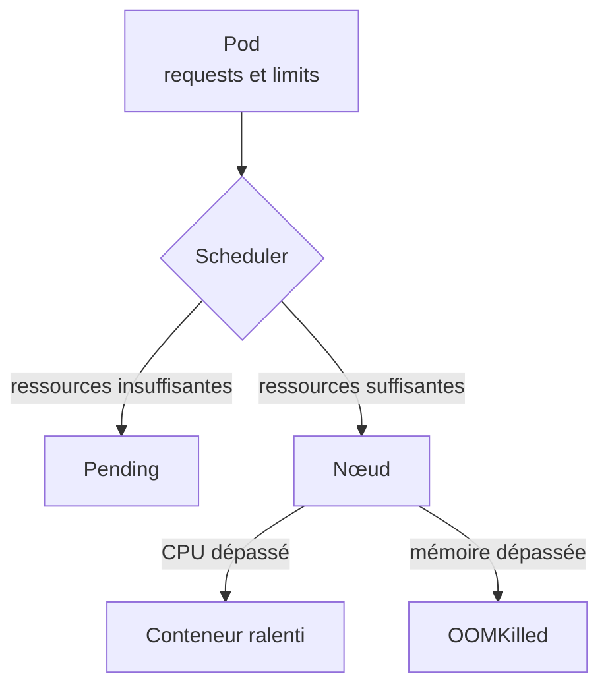

### Étape 1 : Lire la capacité du cluster

```bash
k create namespace tp-k8s
k config set-context --current --namespace=tp-k8s

k get nodes -o custom-columns=NOM:.metadata.name,CPU:.status.allocatable.cpu,MEMOIRE:.status.allocatable.memory
k top nodes
k describe node <nom-du-noeud> | grep -A8 "Allocated resources"
```

> **Résultat** : le CPU et la mémoire allouables de chaque nœud sont connus, et la section *Allocated resources* donne les requests et limits cumulées d'un nœud.

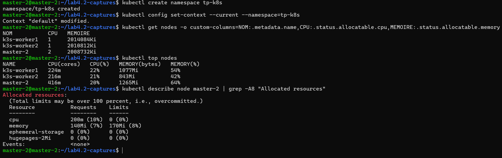

---

### Étape 2 : Déclarer des requests et des limits

```bash
k apply -f lab4.2/yaml/app.yaml
k rollout status deployment/app
k get pods -o wide
k describe pod -l app=app | grep -A6 -E "Limits|Requests" | head -n 14
k top pods
```

| | CPU | Mémoire |
|---|:---:|:-------:|
| **requests** (réservé) | `100m` | `64Mi` |
| **limits** (plafond) | `200m` | `128Mi` |

> **Résultat** : les deux Pods sont `Running`, `describe` affiche les requests et limits, et la consommation réelle (`k top pods`) est bien inférieure aux requests.

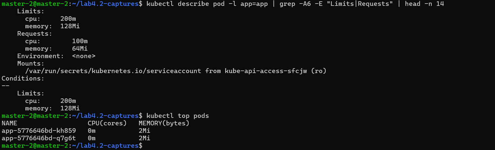

---

### Étape 3 : Diagnostiquer un Pod Pending

```bash
k apply -f lab4.2/yaml/gourmand.yaml     # demande 8Gi de mémoire
k get pods -l app=gourmand
k describe pod -l app=gourmand | tail -n 6

# Correction
sed -i 's|memory: 8Gi|memory: 64Mi|' lab4.2/yaml/gourmand.yaml
k apply -f lab4.2/yaml/gourmand.yaml
```

> **Résultat** : le Pod reste `Pending` avec le message `Insufficient memory` dans les événements. Après correction de la demande, il passe à `Running`.

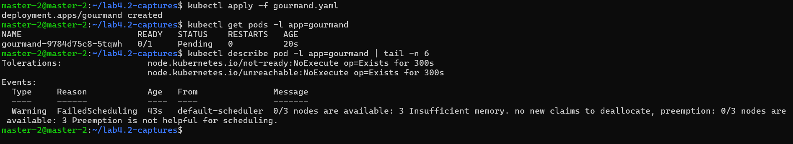

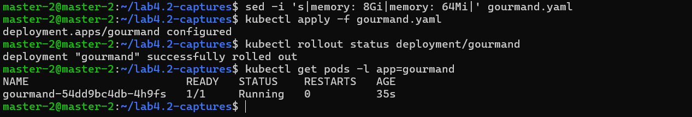

---

### Étape 4 : Provoquer un OOMKilled

Ce Pod tente de stocker environ 100 Mo en mémoire avec une limite de 50 Mi.

```bash
k apply -f lab4.2/yaml/oom.yaml
k get pod oom -w
k describe pod oom | grep -A6 "Last State"
k logs oom
k delete pod oom
```

> **Résultat** : `Last State` indique `Reason: OOMKilled` et le code de sortie `137`. Les logs ne contiennent pas `fini` : le conteneur est tué avant la fin, c'est donc `describe` qui donne la cause.

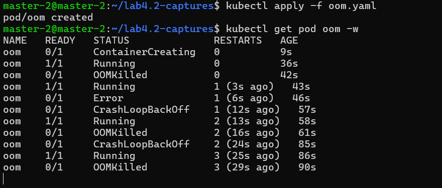

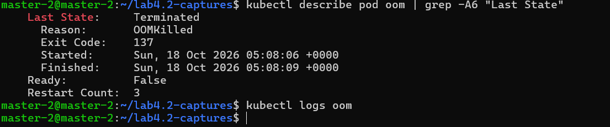

---

### Étape 5 : Observer la limite de CPU

```bash
k apply -f lab4.2/yaml/cpu.yaml
sleep 60
k top pods
k delete -f lab4.2/yaml/cpu.yaml
```

| Pod | Limite CPU | Consommation observée |
|-----|:----------:|:---------------------:|
| `cpu-libre` | aucune | environ 1000m (un cœur entier) |
| `cpu-limite` | `100m` | proche de 100m |

> **Résultat** : le conteneur limité n'est pas arrêté, il est **ralenti**. Le CPU est une ressource compressible, contrairement à la mémoire.

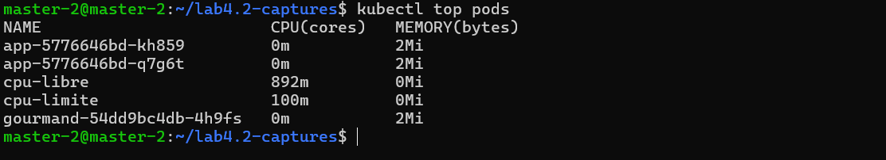

---

### Étape 6 : ResourceQuota puis LimitRange

```bash
k create namespace tp-quota
k config set-context --current --namespace=tp-quota

k apply -f lab4.2/yaml/quota.yaml
k run test --image=nginx:1.26-alpine          # refusé

k apply -f lab4.2/yaml/limitrange.yaml
k run test --image=nginx:1.26-alpine          # accepté
k get pod test -o jsonpath='{.spec.containers[0].resources}'; echo
k describe quota quota
```

| Objet | Rôle | Valeurs |
|-------|------|---------|
| **ResourceQuota** `quota` | Plafonne le namespace | `requests.cpu` 500m, `requests.memory` 512Mi, `limits.cpu` 2, `limits.memory` 1Gi, `pods` 5 |
| **LimitRange** `defaults` | Fournit des valeurs par défaut | requests 50m / 64Mi, limits 200m / 128Mi |

> **Résultat** : sans LimitRange, la création est refusée car le quota impose de déclarer requests et limits. Avec le LimitRange, le Pod `test` est accepté et reçoit automatiquement ses valeurs par défaut. `describe quota` compare `Used` et `Hard`.

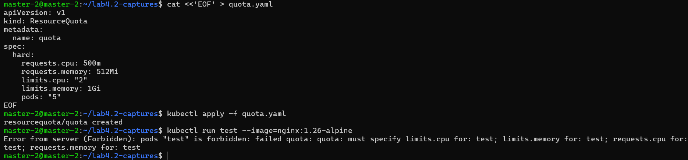

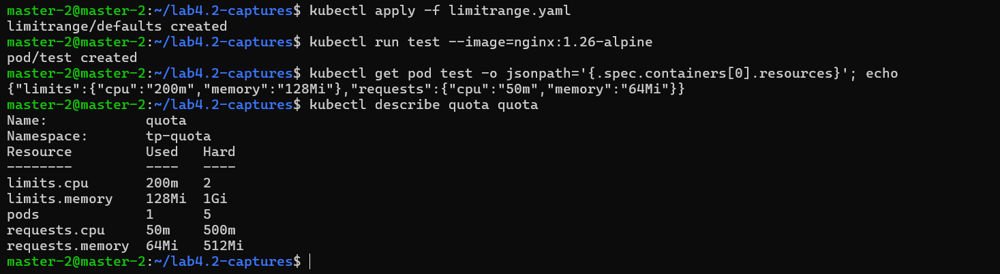

---

### Étape 7 : Dépasser le quota

```bash
k create deployment charge --image=nginx:1.26-alpine --replicas=8
sleep 10
k get deployment charge
k describe quota quota
k describe replicaset -l app=charge | tail -n 8

k apply -f lab4.2/yaml/gros.yaml     # 600m de CPU : refusé

k scale deployment charge --replicas=2
```

> **Résultat** : le Deployment est accepté mais n'atteint jamais ses 8 Pods, car le quota limite à 5 Pods (le Pod `test` compte). Le message `exceeded quota` apparaît dans les événements du **ReplicaSet**. Le Pod `gros` est refusé immédiatement (`Forbidden`). Après réduction à 2 réplicas, `Used` repasse sous `Hard`.

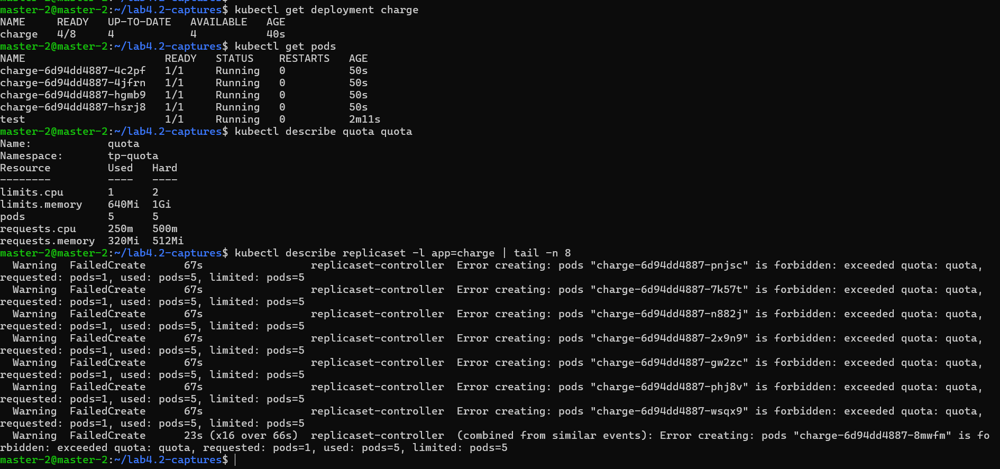

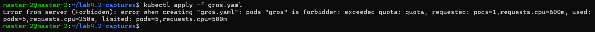

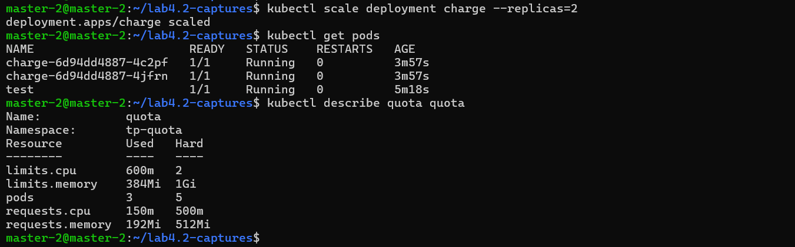

---

### Nettoyage

```bash
k delete namespace tp-quota
k delete namespace tp-k8s
k config set-context --current --namespace=default
```

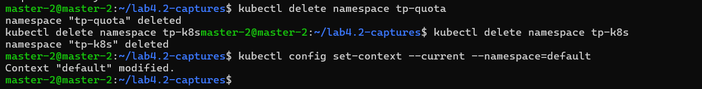

### Questions de réflexion (Lab 4.2)

<details>
<summary><strong>1. Pourquoi un Pod avec <code>requests: memory: 8Gi</code> reste-t-il Pending alors que le conteneur ne consommerait pas autant ?</strong></summary>

Le scheduler se base sur les **requests** (la réservation), pas sur la consommation réelle. Aucun nœud n'a 8 Gi de mémoire non réservée, donc le Pod n'est placé nulle part.
</details>

<details>
<summary><strong>2. Quelle différence entre le dépassement d'une limite de CPU et d'une limite de mémoire ?</strong></summary>

Le CPU est « compressible » : le conteneur est ralenti. La mémoire ne l'est pas : le conteneur est tué (`OOMKilled`) puis redémarré.
</details>

<details>
<summary><strong>3. Où lire la cause d'un OOMKilled ?</strong></summary>

Dans `kubectl describe pod`, section `Last State` : motif `OOMKilled` et code de sortie `137`. Les logs ne le montrent pas, puisque le conteneur est interrompu brutalement.
</details>

<details>
<summary><strong>4. Pourquoi le Pod test a-t-il été refusé avant l'ajout du LimitRange ?</strong></summary>

Le quota porte sur le CPU et la mémoire : chaque Pod doit donc déclarer ses requests et limits. Le LimitRange fournit des valeurs par défaut quand elles sont absentes.
</details>

<details>
<summary><strong>5. Pourquoi le Deployment charge a-t-il été accepté alors que ses Pods ne le sont pas ?</strong></summary>

Le Deployment ne crée pas les Pods lui-même : c'est son ReplicaSet qui le fait. Le quota refuse la création des Pods, d'où l'erreur dans les événements du ReplicaSet et non à l'`apply`.
</details>

### Dépannage (Lab 4.2)

| Symptôme | Pistes |
|----------|--------|
| `k top` : métriques indisponibles | Patienter 1 à 2 minutes ; vérifier les Pods `metrics-server` dans `kube-system` |
| Pod `Pending` | `k describe pod` (Events) : `Insufficient cpu` ou `Insufficient memory`, ou quota ; réduire les requests |
| Le Pod `oom` ne passe pas par `OOMKilled` | Attendre le redémarrage du conteneur, puis consulter `Last State` |
| `cpu-limite` consomme plus que 100m | Attendre la mise à jour des métriques ; refaire `k top pods` après une minute |
| Création refusée : `must specify limits...` | Un quota existe sans LimitRange : ajouter les `resources` ou un LimitRange |
| Création refusée : `exceeded quota` | `k describe quota` : comparer `Used` et `Hard`, puis libérer des ressources |
| Le Deployment reste sous le nombre de réplicas voulu | `k describe replicaset` : chercher l'événement `FailedCreate` |


---

## Auteur

| | |
|---|---|
| **Nom** | Dabbech |
| **Prénom** | Narjess |
| **Classe** | M2 DevOps |
| **GitHub** | [@Narjess805](https://github.com/Narjess805) |
| **Date** | Octobre 2026 |
